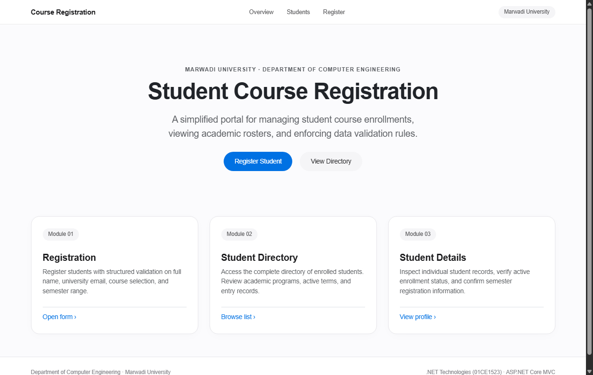
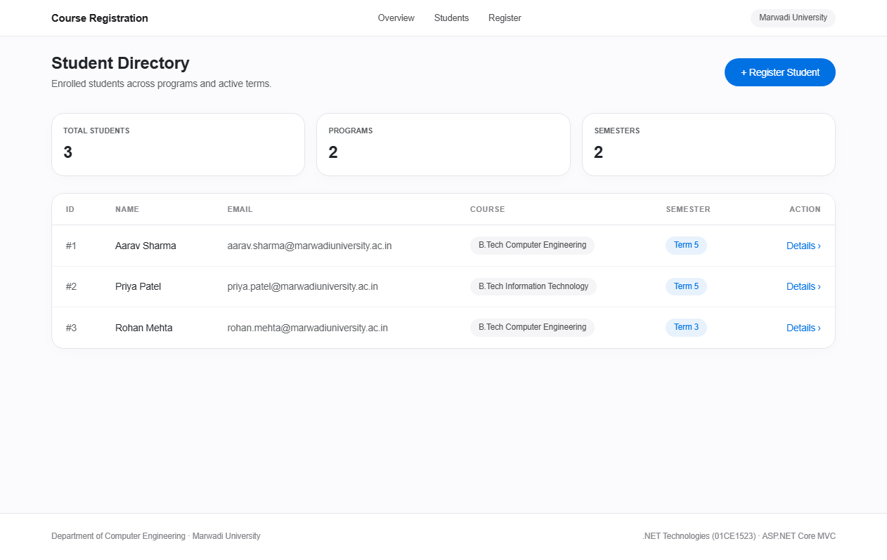
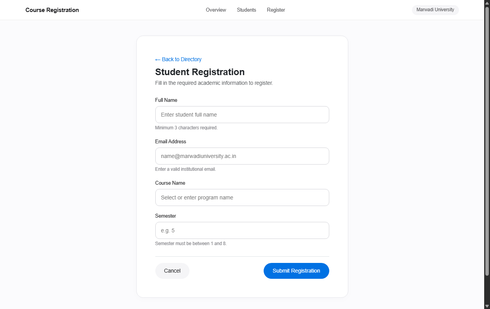
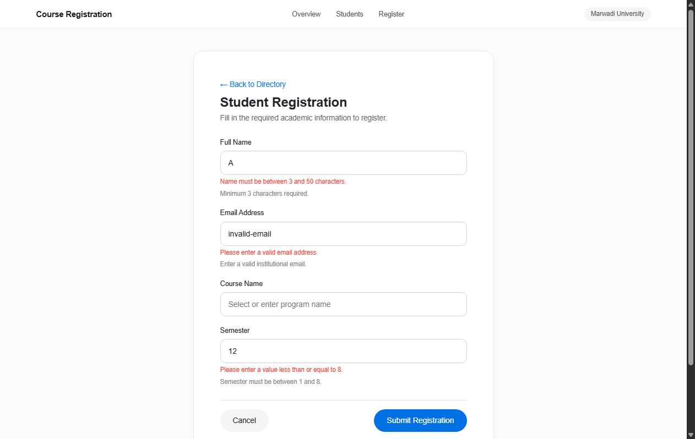
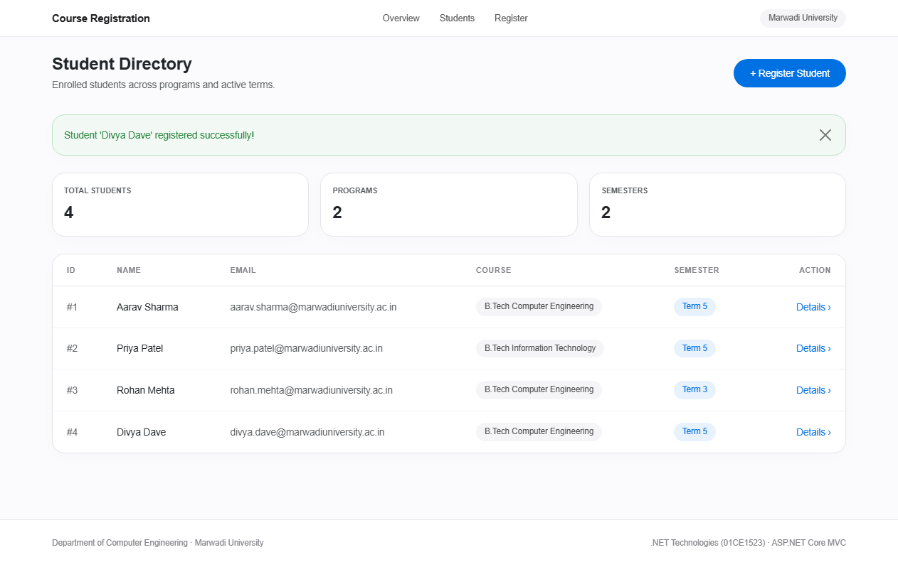
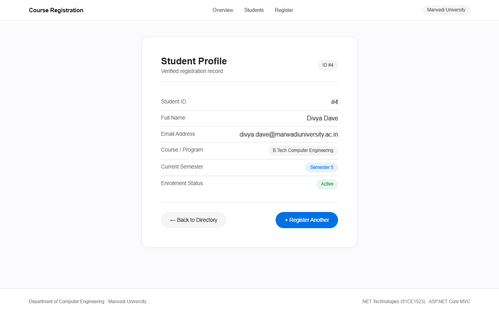

# Self-Learning Activity – ASP.NET Core MVC

**Marwadi University | Department of Computer Engineering**  
**.NET Technologies (01CE1523) | B.Tech Computer Engineering (Semester 5)**  
**Enrollment No:** 92400120641  

---

## Aim
Develop a Student Course Registration System using ASP.NET Core MVC with Models, Razor Views, Controller Action Methods, and Model Validation using Data Annotations.

---

## Learning Objectives
- Understand the fundamentals of ASP.NET Core MVC and the MVC architecture pattern.
- Analyze the structure of an ASP.NET Core project (`Program.cs`, `appsettings.json`, `wwwroot`, `Models`, `Views`, `Controllers`).
- Implement strongly typed Models with Data Annotations for server-side validation.
- Work with Razor Views, Layouts (`_Layout.cshtml`), and modern Tag Helpers (`asp-for`, `asp-action`, `asp-controller`).
- Handle form submissions using Model Binding and `ModelState.IsValid` validation checks.
- Implement the Post-Redirect-Get (PRG) pattern for smooth user workflow.

---

## MVC Architecture & Application Flow
ASP.NET Core MVC enforces Separation of Concerns across three components:
1. **Model (`Models/Student.cs`):** Defines data schema and validation attributes (`[Required]`, `[StringLength]`, `[EmailAddress]`, `[Range]`).
2. **Controller (`Controllers/StudentController.cs`):** Manages requests, binds form data, evaluates `ModelState.IsValid`, and returns views or redirections.
3. **View (`Views/Student/...`):** Presentation layer styled with minimalist Apple design principles and Tag Helpers.

**Application Flow:**
Overview -> Student Registration Form -> Submit Form -> Controller checks `ModelState.IsValid`:
- If invalid: Returns form with highlighted validation errors.
- If valid: Adds student to in-memory list, stores flash confirmation in `TempData`, and redirects to Student Directory (PRG pattern).

---

## Project Structure
- `Models/Student.cs`: Data model with validation rules.
- `Controllers/StudentController.cs`: Controller with `Index()`, `Create()`, and `Details()` action methods.
- `Controllers/HomeController.cs`: Controller for Overview landing page.
- `Views/Student/Index.cshtml`: Student Directory with roster and active counters.
- `Views/Student/Create.cshtml`: Registration form with Tag Helpers.
- `Views/Student/Details.cshtml`: Verified student profile view.
- `Views/Shared/_Layout.cshtml`: Global Apple-style navigation and footer layout.
- `Program.cs`: ASP.NET Core minimal hosting pipeline and conventional routing.

---

## Code

### Models/Student.cs
```csharp
using System.ComponentModel.DataAnnotations;

namespace StudentCourseRegistration.Models
{
    public class Student
    {
        [Display(Name = "Student ID")]
        public int Id { get; set; }

        [Required(ErrorMessage = "Student Name is required.")]
        [StringLength(50, MinimumLength = 3, ErrorMessage = "Name must be between 3 and 50 characters.")]
        [Display(Name = "Full Name")]
        public string Name { get; set; } = string.Empty;

        [Required(ErrorMessage = "Email address is required.")]
        [EmailAddress(ErrorMessage = "Please enter a valid email address.")]
        [Display(Name = "Email Address")]
        public string Email { get; set; } = string.Empty;

        [Required(ErrorMessage = "Course name is required.")]
        [StringLength(60, MinimumLength = 2, ErrorMessage = "Course name must be between 2 and 60 characters.")]
        [Display(Name = "Course Name")]
        public string Course { get; set; } = string.Empty;

        [Required(ErrorMessage = "Semester is required.")]
        [Range(1, 8, ErrorMessage = "Semester must be between 1 and 8.")]
        [Display(Name = "Semester")]
        public int? Semester { get; set; }
    }
}
```

### Controllers/StudentController.cs
```csharp
using Microsoft.AspNetCore.Mvc;
using StudentCourseRegistration.Models;

namespace StudentCourseRegistration.Controllers
{
    public class StudentController : Controller
    {
        private static readonly List<Student> _students = new List<Student>
        {
            new Student { Id = 1, Name = "Aarav Sharma", Email = "aarav.sharma@marwadiuniversity.ac.in", Course = "B.Tech Computer Engineering", Semester = 5 },
            new Student { Id = 2, Name = "Priya Patel", Email = "priya.patel@marwadiuniversity.ac.in", Course = "B.Tech Information Technology", Semester = 5 },
            new Student { Id = 3, Name = "Rohan Mehta", Email = "rohan.mehta@marwadiuniversity.ac.in", Course = "B.Tech Computer Engineering", Semester = 3 }
        };

        public IActionResult Index() => View(_students);

        public IActionResult Create() => View();

        [HttpPost]
        [ValidateAntiForgeryToken]
        public IActionResult Create(Student student)
        {
            if (ModelState.IsValid)
            {
                student.Id = _students.Any() ? _students.Max(s => s.Id) + 1 : 1;
                _students.Add(student);
                TempData["SuccessMessage"] = $"Student '{student.Name}' registered successfully!";
                return RedirectToAction(nameof(Index));
            }
            return View(student);
        }

        public IActionResult Details(int id)
        {
            var student = _students.FirstOrDefault(s => s.Id == id);
            if (student == null) return NotFound();
            return View(student);
        }
    }
}
```

### Views/Student/Create.cshtml
```razor
@model StudentCourseRegistration.Models.Student
@{
    ViewData["Title"] = "Register Student";
}

<div class="row justify-content-center py-3">
    <div class="col-lg-6 col-md-8">
        <div class="apple-card p-4 p-md-5">
            <div class="mb-4">
                <a asp-action="Index" class="btn-apple-link mb-2">&larr; Back to Directory</a>
                <h3 class="h4 fw-semibold text-dark mb-1">Student Registration</h3>
                <p class="text-muted small mb-0">Fill in the required academic information to register.</p>
            </div>

            <form asp-action="Create" method="post" novalidate>
                @Html.AntiForgeryToken()

                <div asp-validation-summary="ModelOnly" class="apple-error mb-3"></div>

                <div class="mb-3">
                    <label asp-for="Name" class="apple-label"></label>
                    <input asp-for="Name" class="apple-input" placeholder="Enter student full name" />
                    <span asp-validation-for="Name" class="apple-error"></span>
                    <div class="apple-hint">Minimum 3 characters required.</div>
                </div>

                <div class="mb-3">
                    <label asp-for="Email" class="apple-label"></label>
                    <input asp-for="Email" type="email" class="apple-input" placeholder="name@marwadiuniversity.ac.in" />
                    <span asp-validation-for="Email" class="apple-error"></span>
                    <div class="apple-hint">Enter a valid institutional email.</div>
                </div>

                <div class="mb-3">
                    <label asp-for="Course" class="apple-label"></label>
                    <input asp-for="Course" class="apple-input" list="courseOptions" placeholder="Select or enter program name" />
                    <datalist id="courseOptions">
                        <option value="B.Tech Computer Engineering"></option>
                        <option value="B.Tech Information Technology"></option>
                        <option value="B.Tech Artificial Intelligence & Data Science"></option>
                        <option value="B.Tech Cyber Security"></option>
                        <option value="Master of Computer Applications (MCA)"></option>
                    </datalist>
                    <span asp-validation-for="Course" class="apple-error"></span>
                </div>

                <div class="mb-4">
                    <label asp-for="Semester" class="apple-label"></label>
                    <input asp-for="Semester" type="number" min="1" max="8" class="apple-input" placeholder="e.g. 5" />
                    <span asp-validation-for="Semester" class="apple-error"></span>
                    <div class="apple-hint">Semester must be between 1 and 8.</div>
                </div>

                <div class="d-flex justify-content-between align-items-center pt-3 border-top">
                    <a asp-action="Index" class="btn-apple-secondary">Cancel</a>
                    <button type="submit" class="btn-apple-primary">Submit Registration</button>
                </div>
            </form>
        </div>
    </div>
</div>

@section Scripts {
    @{await Html.RenderPartialAsync("_ValidationScriptsPartial");}
}
```

---

## Output

### 1. Home Page (Overview)


### 2. Student Directory


### 3. Student Registration Form


### 4. Model Validation with Data Annotations (Error Display)


### 5. Successful Registration & Post-Redirect-Get (PRG) Confirmation


### 6. Student Profile Details Page


---

## Challenges Faced and Solutions
- **Nullable Value Types in Validation:** Defined `Semester` as `int?` rather than primitive `int`, ensuring missing inputs register as `null` and trigger `[Required]` rather than defaulting to `0`.
- **Preventing Duplicate Form Posts:** Implemented the Post-Redirect-Get (PRG) pattern with `RedirectToAction(nameof(Index))` so page reloads do not trigger duplicate HTTP POSTs.
- **Cross-Redirect State Persistence:** Used `TempData["SuccessMessage"]` to display confirmation feedback upon successful registration across redirects.

---

## Learning Outcomes
- Understood the complete ASP.NET Core MVC lifecycle from routing to view rendering.
- Mastered Data Annotation attributes (`[Required]`, `[StringLength]`, `[Range]`, `[EmailAddress]`) for robust server-side validation.
- Utilized Razor Tag Helpers (`asp-for`, `asp-action`, `asp-controller`, `asp-validation-for`) for clean, readable views.
- Implemented minimalist, user-focused UI design adhering to Apple design principles.

---

## Conclusion
The Student Course Registration System was successfully developed and tested. All technical requirements, model validations, controller actions, and views are fully functional.

**Github URL:( https://github.com/GHrushikesh/.Net-Practicals/tree/main/Self_Learning_Activity )**
